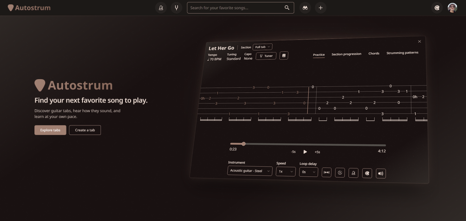

# Autostrum 🎸

Autostrum is a browser-based guitar tab editor and player. Discover songs, write
tabs, and practice with audio playback.

## Features

- Guitar playback with adjustable tempo, loop ranges, count-in, and autoscroll.
- A tab editor with chord blocks, reusable strumming patterns, custom tunings,
  capo and tempo changes, keyboard shortcuts, undo/redo, and private drafts.
- Guitar Pro import and printable tabs.
- Search by song or artist; filter by genre, tuning, capo, and difficulty.
  Publish tabs, bookmark songs, and browse artist and creator profiles.
- Practice tools: warm-ups, scales, chord trainer, metronome, note trainer,
  and a microphone-based tuner.
- Light/dark themes, color palettes, zoom, and left-handed chord diagrams.

## Development

The app uses Next.js App Router, React, TypeScript, tRPC, Prisma/PostgreSQL,
Clerk, and Tailwind CSS with shadcn components built on Base UI.

Install dependencies with `npm install`. Configure the environment variables
validated in [src/env.js](src/env.js), then run `npm run dev`.
The database, authentication, S3 storage, and screenshot service are remote;
there are no local services to provision beyond the web app.

- `npm run lint` runs ESLint.
- `npm run test:e2e -- --list` lists Playwright tests without running them.
- [E2E setup](docs/e2e.md) covers authentication and the tab publish/delete test.
- `npm run build` generates theme tokens and Prisma's client, deploys database
  migrations, and builds Next.js. Use `npx next build` for a compile without
  deploying migrations, after generating the client and theme tokens.

Architecture and maintenance notes are in [docs](docs/). The scripts in
[scripts](scripts/) include regression checks and asset maintenance tools;
check each script's usage before running it, since some need a running app or
access to the shared database.

## Credits

Built with the [T3 Stack](https://create.t3.gg/),
[shadcn/ui](https://ui.shadcn.com/), [Base UI](https://base-ui.com/),
[Clerk](https://clerk.com/),
[alphaTab](https://alphatab.net/),
[soundfont-player](https://github.com/danigb/soundfont-player), and the
[Web Audio API](https://developer.mozilla.org/en-US/docs/Web/API/Web_Audio_API).

[React Guitar](https://github.com/4lejandrito/react-guitar) inspired the tuning
list and the approach to rendering and playing notes in the browser.
