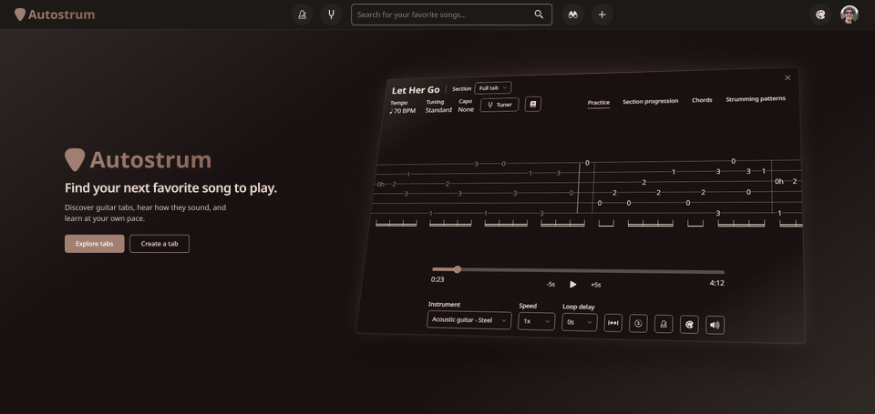

# Autostrum 🎸

I built **Autostrum** because I wanted a single place in the browser where guitar players could discover songs, actually *hear* how a tab is supposed to sound, and jot down their own musical ideas without fighting clunky software. 

Whether you're trying to nail a tricky solo, transcribing a favorite song, or just running through your daily warm-ups, Autostrum brings an interactive tab player, a fast tab editor, and a collection of practice tools together under one roof.

## Practice at your own pace

Reading static text tabs works fine until you can't figure out the rhythm. Every tab on Autostrum plays back using sampled acoustic or electric guitar audio, highlighting notes and chords in real time so you can hear the groove before you even pick up your guitar.

- **Slow down the tricky parts:** Drop the tempo while you get a difficult passage under your fingers, then gradually bring it back up to speed.
- **Loop the bars giving you trouble:** Highlight a specific phrase to put it on repeat. You can add a count-in and a short pause between loops so you actually have time to reset your hands.
- **Stay in the flow:** Let autoscroll move the page for you, jump straight between song sections, or click any chord to start playback right from that exact spot.
- **Customize your view:** Adjust the zoom, turn on color-coded chords, pin chord diagrams and section navigation to your screen, or flip the diagrams if you play left-handed.
- **Dial in your sound:** Switch between acoustic and electric guitar tones and tweak the playback volume to sit nicely in your mix.

## Write tabs without the headache

Most tab editors feel like doing data entry in a spreadsheet. Autostrum’s editor is designed to get musical ideas out of your head and onto the page as fast as possible. You can mix single-note tablature with chord blocks and reusable strumming patterns, listening back to your arrangement as you write.

- **Don't repeat yourself:** Build a strumming pattern or a section once, then organize your song's progression by duplicating, reordering, and looping sections without having to rewrite a single note.
- **Match your guitar's setup:** Pick from preset tunings (or create a custom one), slap on a virtual capo, and program tempo changes mid-song where the music calls for it.
- **Work fast from the keyboard:** Navigate the fretboard with your arrow keys, use hotkeys to punch in chords and change note lengths, and easily copy, paste, undo, and redo.
- **Never lose a riff:** Automatic draft saving keeps your work safe in the background, so you can close your browser and come back to an unfinished idea whenever inspiration strikes.
- **Share with the community:** When a tab is ready, tag it with the artist, genre, and difficulty level, and publish it for other players to learn.

## Built-in guitar tools

Sometimes you just want to work on your chops instead of learning a full song. Autostrum includes a set of standalone tools to help you build a solid practice routine:

- **Warm-up Exercises:** Play along with interactive exercises for finger strength, coordination, and dexterity across different skill levels.
- **Scales Practice:** Visualize scale patterns across the fretboard and practice moving through them with interactive audio playback.
- **Chord Trainer:** Smooth out your chord transitions using preset progressions or your own custom problem-chords, complete with strumming patterns and adjustable tempo.
- **Metronome:** Dial in your timing with custom time signatures, subdivisions, and downbeat accents. Use tap tempo to find a beat, or turn on *Speed Trainer* mode to gradually bump up the BPM as you play.
- **Note Trainer:** Train your ear by listening to isolated notes and identifying them, with customizable note sets and audio sources.
- **Guitar Tuner:** Tune up using your device's microphone, with full support for alternate and custom tunings.

## Find your next song to learn

Search for songs and artists with instant suggestions as you type, or browse through newly added tabs, popular tracks, genres, and weekly featured creators.

- **Filter by how your guitar is set up right now:** Don't feel like retuning or hunting for your capo? Filter tabs by tuning, capo usage, genre, and difficulty to find something you can play immediately.
- **Browse your way:** Flip between grid and table layouts, and sort results by relevance, date, or popularity.
- **Go down the rabbit hole:** Check out artist and creator profiles, or follow related-tab recommendations based on songs you already enjoy.
- **Build your songbook:** Bookmark tabs you want to learn later and keep all of your own published work neatly organized on your profile.

## Built with

This project wouldn't have been possible without these awesome tools and libraries:

- The [T3 Stack](https://create.t3.gg/)
- [shadcn/ui](https://ui.shadcn.com/)
- [Clerk](https://clerk.com/)
- [soundfont-player](https://github.com/danigb/soundfont-player)
- The [Web Audio API](https://developer.mozilla.org/en-US/docs/Web/API/Web_Audio_API)

## Inspiration

I wouldn't have known where to start without the incredible [React Guitar](https://github.com/4lejandrito/react-guitar) library. I borrowed its generous list of tunings and took heavy inspiration from its approach to rendering and playing notes in the browser.
